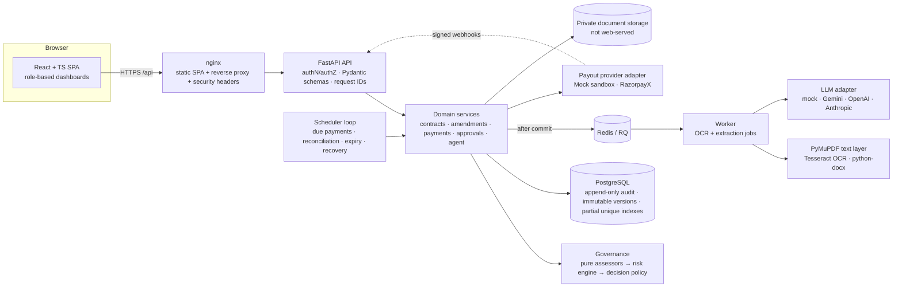

# Architecture



## Layers

| Layer | Location | Responsibility |
|---|---|---|
| API | `backend/finguard/api/v1/*` | HTTP, validation (Pydantic), principal resolution, explicit serializers. No business rules. |
| Authorization | `finguard/authz/` | RBAC catalog, `Principal`, ABAC helpers (tenant scope, ownership, SoD, approval limits). Called from services, not only routes. |
| Services | `finguard/services/` | Contract lifecycle state machine, OCR job orchestration, amendments, payments, approvals, beneficiaries/invoices, auth, audit, notifications. |
| Governance | `finguard/governance/`, `finguard/risk/` | **Single authoritative risk decision service.** `assessors.py` turns snapshots into factors + hard rules; `risk/engine.py` computes `Risk = 3S+5F+3I+3E+3T+3U`; `policy.py` decides ACT/APPROVE/ESCALATE/VERIFY/BLOCK. Pure functions — no DB, network or LLM. |
| Scheduling | `finguard/scheduling/generator.py` | Deterministic schedule generation (calendar months, month-end clamping, business days, DST, proration). |
| Documents & extraction | `finguard/documents/`, `finguard/extraction/` | Upload validation, private storage, text layer + OCR, rule extraction with provenance, injection detection, optional LLM proposals validated against source text. |
| Payments | `finguard/payments/providers/` | Provider interface; deterministic mock sandbox; RazorpayX adapter. |
| Agent | `finguard/agent/` | Planner (LLM or deterministic), allowlisted tools executed with the delegating user's permissions, evidence-grounded answers. |
| Workers | `finguard/worker/` | Post-commit dispatch, RQ worker, durable scheduler loop with heartbeats. |
| Evaluation | `finguard/evaluation/` | Derived task set, policy comparison harness, calibration, ablations, OCR accuracy. |

## Why one risk service

The earlier prototypes (TypeScript `engine.ts`, Python `risk_engine.py`, Finguard-v3) used three different formulas. This
build has exactly one implementation (`governance/assessors.py` + `risk/engine.py`), called by the live services **and**
by the evaluation harness on identical snapshot types. The 35-task calibration set is re-scored with the authoritative
formula (its stored composite scores came from an older formula and are kept only for provenance).

## Key flows

```mermaid
sequenceDiagram
  participant C as Contractor
  participant API
  participant W as Worker
  participant A as Analyst
  participant P as Approver
  participant S as Scheduler
  participant X as Payout provider
  C->>API: upload contract (PDF/scan/image/DOCX)
  API->>API: validate magic bytes, hash, store privately, DRAFT→UPLOADED
  API-->>W: OCR job (after commit)
  W->>W: text layer / OCR → rules (+LLM proposal) → provenance → NEEDS_REVIEW
  C->>API: correct fields (reason) → submit → PENDING_VALIDATION
  A->>API: validate (checks) → PENDING_APPROVAL; risk assessment → approval request
  P->>API: approve (limits, SoD, hard rules re-checked) → new immutable version → ACTIVE + schedule
  S->>API: due occurrence → snapshot → assess → ACT / APPROVE / ESCALATE / VERIFY / BLOCK
  S->>X: ACT: durable intent (CREATED, idempotency key) committed, then create payout
  X-->>API: signed webhook (deduplicated, amount/currency/reference checked)
```

## Data model highlights

* UUID primary keys; `NUMERIC(18,2)` for money; status vocabularies enforced by CHECK constraints.
* `contract_versions` are immutable once APPROVED (trigger allows only APPROVED→SUPERSEDED).
* `audit_logs`, `risk_assessments`, `governance_decisions`, `approval_decisions`, `extracted_fields`, `field_corrections`,
  `contract_validations`, `contract_approvals`, `extraction_results` are append-only (UPDATE/DELETE/TRUNCATE raise).
* `scheduled_payments`: unique live occurrence per (contract, period); unique idempotency key.
* `payment_attempts`: at most one live/successful attempt per occurrence (partial unique index); core fields immutable.
* `payment_provider_events`: unique (provider, event_id) for webhook idempotency.
* Audit entries are SHA-256 hash-chained (`/api/v1/audit/verify`).
